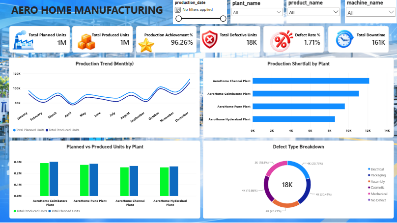

# 🏠 Aero Home – Power BI Sales Analytics Dashboard

## 📌 Project Overview
Aero Home is a Power BI data analytics project designed to analyze business performance through interactive dashboards and visual reports. The project focuses on presenting key business insights to support data-driven decision-making.

## 🎯 Objectives
- Analyze business performance using Power BI.
- Track important KPIs and performance trends.
- Present data through interactive visualizations.
- Identify patterns and insights to support business decisions.

## 🛠️ Tools & Technologies
- **Power BI Desktop** – Dashboard development and visualization
- **DAX** – KPI calculations and measures
- **Power Query** – Data transformation and cleaning
- **Data Analytics** – Business insights and performance analysis

## 📊 Key Features
- Interactive dashboard and visual reports
- KPI-based performance monitoring
- Data cleaning and transformation
- Business trend analysis
- Visual representation of key metrics

## 💡 Key Learnings
- Developed practical skills in Power BI dashboard design.
- Practiced data preparation and transformation.
- Improved understanding of data visualization and business reporting.
- Gained experience in presenting data-driven insights.

## 🚀 How to Explore
1. Open the `.pbix` file in Microsoft Power BI Desktop.
2. Explore the dashboard pages, visualizations, and available filters.
3. Review the dashboard preview displayed above.

## 👨‍💻 Author
**Logesh S**

*Aspiring Data Analyst | Power BI | SQL | Excel | Python*
