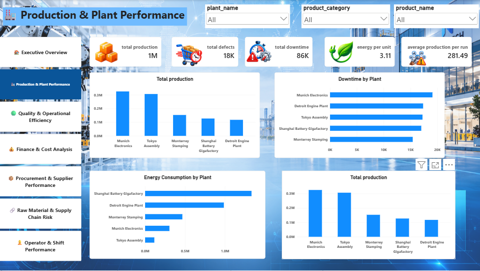

# 🏭 NoviTech Manufacturing – Power BI Dashboard

## 📌 Project Overview

An interactive **Manufacturing Analytics Dashboard** developed using **Microsoft Power BI** to monitor and analyze production, quality, operations, finance, procurement, supply chain, and workforce performance.

The dashboard provides management with a centralized view of manufacturing operations through interactive KPIs, charts, trends, slicers, and business insights.

## 📊 Dashboard Pages

- 🏠 **Executive Overview** – Overall manufacturing KPIs and business performance
- 🏭 **Production & Plant Performance** – Production targets and plant-wise performance
- 🛡️ **Quality & Operational Efficiency** – Defects, downtime, and operational efficiency
- 💰 **Finance & Cost Analysis** – Manufacturing costs and financial performance
- 📦 **Procurement & Supplier Performance** – Procurement spending and supplier analysis
- 🚚 **Raw Materials & Supply Chain Risk** – Material availability and supply chain risks
- 👷 **Operator & Shift Performance** – Operator productivity and shift-wise performance

## 🛠️ Tools & Technologies

- Microsoft Power BI
- Power Query
- DAX
- Data Modeling
- Data Cleaning
- Data Visualization

## 📈 Key Features

- Interactive KPI cards and visual reports
- Dynamic slicers and filters
- Plant-wise production analysis
- Quality and defect monitoring
- Downtime and operational analysis
- Finance and cost analysis
- Supplier performance tracking
- Procurement and supply chain risk analysis
- Operator and shift performance analysis
- Interactive page navigation

## 🎯 Business Benefits

- Monitor production performance
- Identify quality and operational issues
- Track manufacturing costs
- Evaluate supplier performance
- Identify supply chain risks
- Analyze workforce productivity
- Improve operational efficiency
- Support data-driven business decisions

## 📁 Project Files

- `Novi_Tech.pbix` – Power BI dashboard project file
- `Novi_tech.png` – Dashboard preview image

## 🚀 How to Explore

1. Download `Novi_Tech.pbix` from this repository.
2. Open the file using Microsoft Power BI Desktop.
3. Explore the seven dashboard pages and available filters.

## 💡 Skills Demonstrated

**Power BI | Power Query | DAX | Data Modeling | Data Analytics | Data Visualization | Business Intelligence**

---

⭐ A practical Power BI project focused on real-world manufacturing and operations analytics.

## 👨‍💻 Author

**Logesh S**

*Aspiring Data Analyst | Power BI | SQL | Excel | Python*
